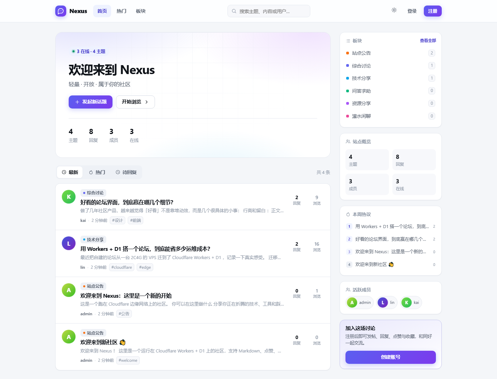
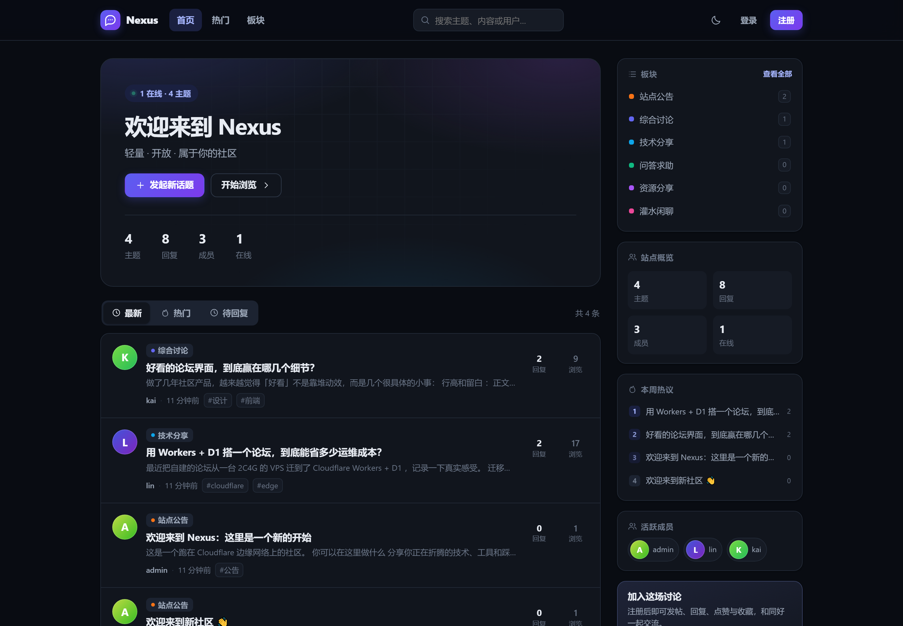
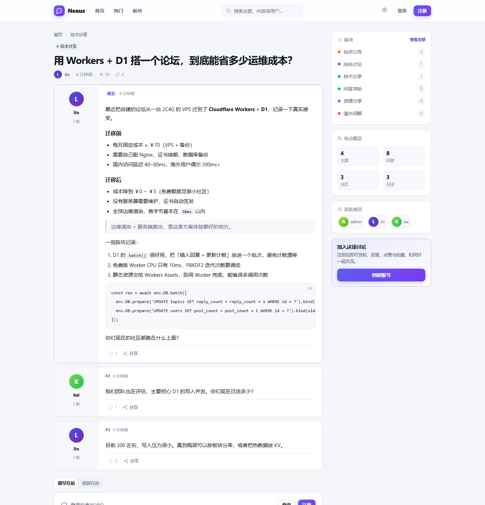
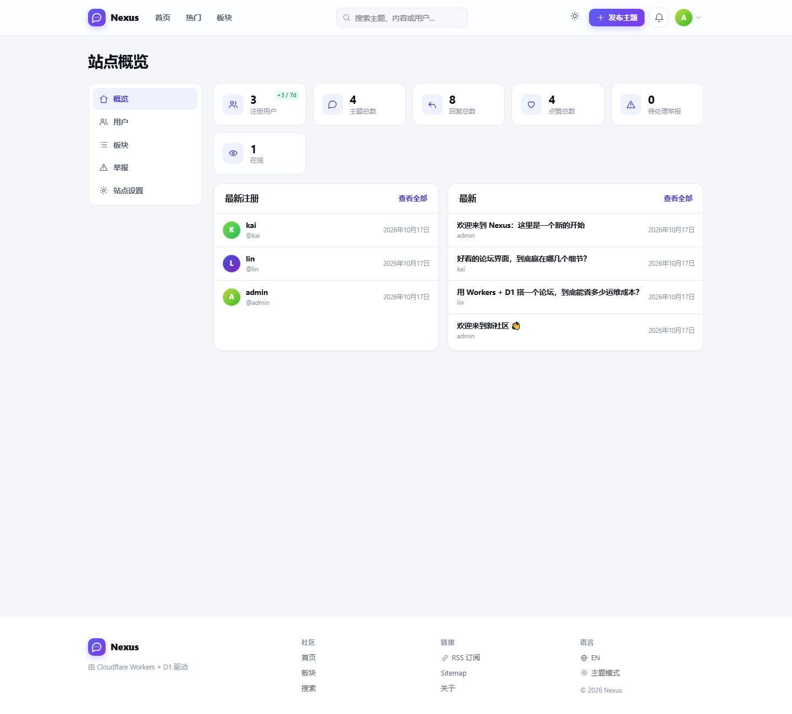
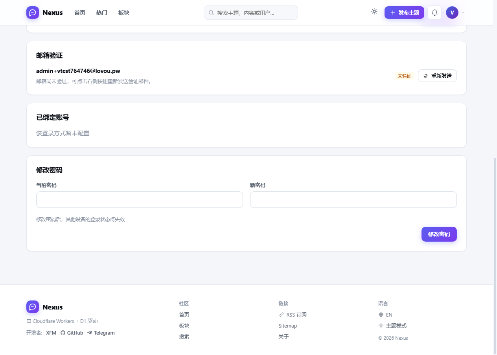

# cf-bbs · Nexus

[中文](README.md) | [English](README.en.md)

一个可以直接跑在 **Cloudflare Workers + D1** 上的轻量社区论坛。SSR 渲染、零运行时依赖、内置多语言与多平台 OAuth 登录。

```bash
npm install
npx wrangler d1 create cf-bbs          # 把返回的 database_id 填进 wrangler.toml
npm run db:migrate && npm run db:seed  # 本地
npm run dev                            # http://localhost:8787
```

首次打开会自动进入 `/setup`，创建第一个管理员账号（同时生成一篇欢迎主题），随后即可使用。

## 界面预览

| 首页（亮色） | 首页（暗色） |
| --- | --- |
|  |  |

| 主题详情 | 管理后台 |
| --- | --- |
|  |  |

移动端与登录页：`docs/screenshots/mobile.png`、`docs/screenshots/login.png`。

---

## 特性

**轻量 · 高性能**

- 单个 Worker、零运行时依赖（不引入 Hono/React/ORM），全部逻辑约 6k 行 TypeScript
- 服务端直出 HTML，首屏无 JS 依赖；CSS/JS 由 Workers Static Assets 直接返回，不消耗 Worker 调用
- 页面级 SQL 都走索引，列表分页、计数、关系数据一次查询完成；写操作使用 `DB.batch()` 保证一致性
- 点赞 / 收藏 / 回复预览为渐进增强：没有 JS 也能用（表单回退）

**功能**

- 板块、主题、楼层回复、Markdown（代码块 / 引用 / 列表 / 图片 / @提及）
- **私信**：用户间点对点会话，气泡式界面、未读角标、打开即已读，封禁/禁言用户不可收发
- **标签系统**：发帖打标签，`/tags` 标签云 + `/tags/:name` 单标签主题列表
- **提及页**：个人主页 `?tab=mentions` 聚合被 @ 的主题；@某人自动发通知
- **草稿**：发帖、回复、私信内容自动保存到本地，误关页面不丢内容
- 点赞、收藏、通知（回复 / 提及）、举报与版务处理
- 角色：成员 / 版主 / 管理员；置顶、加精、锁定、删除
- **用户禁言**：管理员可禁言 1 小时 ~ 30 天，禁言期间无法发帖、回复、发私信，到期自动恢复
- 搜索、用户主页、个人设置、密码修改、账号绑定
- 管理后台：概览指标、用户管理（角色/封禁/禁言）、**帖子管理（主题+回复，硬删除）**、板块 CRUD、举报队列、**审计日志**、站点设置（站名 / 公告 / 关闭注册）
- RSS、sitemap.xml、robots.txt、OG 标签、canonical
- 亮色 / 暗色 / 跟随系统，响应式（移动端底部导航化）

**安全**

- 会话：HMAC-SHA256 签名令牌（HttpOnly + SameSite=Lax + Secure），支持 `token_version` 全端下线
- 密码：PBKDF2-SHA256（默认 10 万次迭代，可用 `PASSWORD_ITERATIONS` 调整）
- CSRF：双提交 Cookie + 表单隐藏域 / `X-CSRF-Token`，常量时间比较
- XSS：Markdown 先整体转义再生成标签，链接仅允许 `http(s)` 与站内路径
- 响应头：CSP、X-Frame-Options、nosniff、Referrer-Policy、HSTS、Permissions-Policy
- 限流：登录/注册、发帖、私信、API 多档限流（可在控制台叠加 WAF Rate Limiting）

**国际化**

- 内置 `zh-CN` / `en-US` 两套完整词条，服务端按 `Cookie → 用户偏好 → Accept-Language` 协商
- 板块名与描述本身也是双语字段；页脚可一键切换语言
- 新增语言：在 `src/lib/i18n.ts` 里加一份字典 + 一处 `LOCALES` 即可

---

## OAuth 登录

内置 6 种登录方式，**配了环境变量即自动出现在登录页**，未配置则隐藏：

| Provider | 变量 | 回调地址 |
| --- | --- | --- |
| GitHub | `GITHUB_CLIENT_ID` / `GITHUB_CLIENT_SECRET` | `https://你的域名/auth/github/callback` |
| Google | `GOOGLE_CLIENT_ID` / `GOOGLE_CLIENT_SECRET` | `https://你的域名/auth/google/callback` |
| GitLab | `GITLAB_CLIENT_ID` / `GITLAB_CLIENT_SECRET` | `https://你的域名/auth/gitlab/callback` |
| Gitee | `GITEE_CLIENT_ID` / `GITEE_CLIENT_SECRET` | `https://你的域名/auth/gitee/callback` |
| Discord | `DISCORD_CLIENT_ID` / `DISCORD_CLIENT_SECRET` | `https://你的域名/auth/discord/callback` |
| 通用 OIDC | `OIDC_ISSUER` / `OIDC_CLIENT_ID` / `OIDC_CLIENT_SECRET` / `OIDC_NAME` | `https://你的域名/auth/oidc/callback` |

通用 OIDC 兼容 Keycloak、Authentik、Auth0、Okta、Linux.do 等任何提供 `.well-known/openid-configuration` 的服务；`OIDC_NAME` 用于自定义按钮文案（如 `Linux.do`）。

设置方式：

```bash
npx wrangler secret put GITHUB_CLIENT_ID
npx wrangler secret put GITHUB_CLIENT_SECRET
npx wrangler secret put SESSION_SECRET      # 必填，32 位以上随机串
```

已有账号可在「设置 → 已绑定账号」中绑定/解绑第三方登录；OAuth 首次登录时若邮箱已验证并且站点存在同邮箱账号，会自动合并。

---

## 图床集成（编辑器上传图片）

支持把外部图床（Sanyue ImgHub / CloudFlare-ImgBed 系，即提供 `POST /upload?authCode=` 接口的服务）接入编辑器：发帖与回复时**点击工具栏图片按钮、直接粘贴截图或拖拽图片**，自动上传并插入 ``。

工作方式：浏览器只和本站的 `/api/upload` 通信，Worker 转发上传到图床——**认证码只存在服务端，不会暴露给前端**。同时要求登录、校验图片类型、限制单张大小（默认 8MB）与每人 30 张/10 分钟。

配置（两项同时存在才会启用，缺一自动隐藏上传入口）：

```toml
# wrangler.toml [vars]
IMGBED_URL = "https://img.lovou.eu.org"   # 图床根地址
# IMGBED_FOLDER = "bbs"                   # 可选：上传目录
# IMGBED_CHANNEL = "telegram"             # 可选：telegram / cfr2 / s3
# IMGBED_MAX_MB = "8"                     # 可选：单张上限（MB）
# IMGBED_COMPRESS = "1"                   # 可选：交给图床压缩（默认关）
# IMGBED_AUTO_RETRY = "1"                 # 可选：失败自动切渠道（默认关）
```

> 默认会带上 `serverCompress=false&autoRetry=false`：前者在部分渠道会直接 400，后者会把未配置渠道的错误合并返回，出现「明明传上去了却报 500」。

```bash
npx wrangler secret put IMGBED_AUTH_CODE   # 图后台设置的认证码
```

上传成功返回 `data[0].src`，相对路径会自动补全为图床绝对地址；图片域名已在 CSP `img-src https:` 白名单内，帖子内可直接渲染。

---

## 邮箱验证（Resend）

注册后自动发送验证邮件，点链接即完成验证（令牌 24 小时有效、一次性使用、只存 SHA-256 摘要）。设置页有独立卡片显示验证状态并提供「重新发送」；修改邮箱会自动重发并把状态重置为未验证。



```bash
npx wrangler secret put RESEND_API_KEY   # Resend 后台创建
npx wrangler secret put MAIL_FROM        # 如 "Nexus <noreply@lovou.pw>"，域名需在 Resend 验证
# 可选
npx wrangler secret put MAIL_REPLY_TO
```

`wrangler.toml` 里控制行为：

```toml
SITE_URL = "https://forum.lovou.pw"           # 邮件链接前缀，自定义域必填
REQUIRE_EMAIL_VERIFICATION = "true"           # true = 未验证不能发帖 / 回复
```

- 未配置 `RESEND_API_KEY` / `MAIL_FROM` 时：注册照常成功，验证链接只打印在 `wrangler tail` 日志里，前端不显示验证横幅，也不会因为强制验证把人锁死
- 开启 `REQUIRE_EMAIL_VERIFICATION` 后，未验证用户仍可浏览 / 搜索，但发帖与回复会被拦回编辑器并在顶部常驻提示；老账号需要在「设置 → 邮箱验证」点「重新发送」完成验证
- 重发限流：同账号 60 秒冷却 + 每人 3 封 / 10 分钟
- Resend 未验证域名时只能发到账号自己的邮箱，正式上线前记得先验证发信域名

---

## 全文搜索（FTS5）

搜索走 D1 内置的 FTS5 虚拟表（定义在 `migrations/0000_init.sql`），索引主题标题 / 摘要 / 标签与**回复正文**：

- `trigram` 分词：不依赖中文词典，中英文都按子串匹配，`snippet()` 直接给出命中片段并高亮
- `bm25` 相关度排序，标题权重 8、正文权重 1
- 查询词短于 3 字符（如中文两字词）时自动回退 `LIKE`；索引异常同样回退，不会因为搜索报 500
- 触发器维护索引：主题新增/改标题/软删除/恢复、回复新增/编辑/软删除/硬删除都会同步

重建索引（批量导入数据后、或怀疑索引不一致时）：

```bash
npm run search:reindex              # 本地
npm run search:reindex -- --remote  # 线上
```

> trigram 是子串匹配：连写的长中文词需要是原文中连续出现的片段；用空格分词可以得到 AND 语义（如 `论坛 界面`）。

---

## 部署

### 方式 A：一键部署（本地一条命令）

```bash
npx wrangler login   # 只需第一次
npm run ship
```

`scripts/deploy.mjs` 会串起整条链路，任何一步失败立即停下并打印真实错误：

1. 检查依赖与 Cloudflare 登录态
2. `wrangler.toml` 里 `database_id` 仍是占位值时，自动 `d1 create` 并写回
3. 首次部署自动生成 48 字节随机 `SESSION_SECRET` 并写入（已存在则不动，不会让现有会话失效）
4. 应用 D1 迁移（无变更自动跳过）
5. 写入初始板块（`INSERT OR IGNORE`，可重复执行）
6. TypeScript 严格校验 → `wrangler deploy`
7. 轮询 `/healthz` 确认线上可用，并输出站点与后台地址

常用参数：

| 命令 | 作用 |
|---|---|
| `npm run ship` | 完整部署 |
| `npm run ship -- --skip-seed` | 不动板块数据（日常发布最常用） |
| `npm run ship -- --skip-migrate` | 跳过数据库迁移 |
| `npm run ship:dry` | 只打包校验，不真正发布 |
| `npm run ship -- --rotate-secret` | 强制轮换 `SESSION_SECRET`（会让所有已登录用户下线） |
| `npm run ship -- --yes` | 全程不询问（CI / 定时任务） |

> 密钥处理是保守的：只有确认线上**没有** `SESSION_SECRET` 时才自动生成写入；查询失败会跳过并提示，绝不会因为一次网络抖动把全员登出。

### 方式 B：GitHub Actions（推送即部署）

[](https://deploy.workers.cloudflare.com/?url=https://github.com/xfm0797/cloudflare-workers-bbs-Nexus)

仓库已带 `.github/workflows/deploy.yml`：**push 到 `main` 自动发布**，也可以在 Actions 页面点 **Run workflow** 手动触发（可勾选是否迁移、是否写入初始板块）。没配密钥时流水线只做类型检查并提示跳过，不会出现失败记录。

首次启用需在仓库 `Settings → Secrets and variables → Actions` 配置：

| 类型 | 名称 | 说明 |
|---|---|---|
| Secret | `CLOUDFLARE_API_TOKEN` | **必填**。Cloudflare 后台创建，权限：`Workers Scripts:Edit`、`D1:Edit`、`Account Settings:Read` |
| Secret | `CLOUDFLARE_ACCOUNT_ID` | 可选，账号 ID（多账号时建议填） |
| Secret | `SESSION_SECRET` | 可选，填了则每次部署同步会话密钥（不填则沿用线上已有值） |
| Variable | `D1_DATABASE_ID` | 可选，fork 后用自己的数据库时覆盖 `wrangler.toml` 里的 id |

> 用别人的仓库部署自己的站：先 Fork → 删掉 `wrangler.toml` 里的 `[[routes]]` 段（否则会尝试绑定原作者的域名）→ 需要的话改 `name` → 按上表配好 `CLOUDFLARE_API_TOKEN`（和自己的 `D1_DATABASE_ID`）→ 点 Run workflow。

### 方式 C：手动分步

1. **创建 D1**

   ```bash
   npx wrangler d1 create cf-bbs
   ```

   将输出的 `database_id` 写入 `wrangler.toml`。

2. **初始化线上库**

   ```bash
   npx wrangler d1 migrations apply cf-bbs --remote
   npx wrangler d1 execute cf-bbs --remote --file=./seed.sql
   ```

3. **设置密钥**

   ```bash
   npx wrangler secret put SESSION_SECRET
   ```

   可选：在 `wrangler.toml` 的 `[vars]` 里修改 `SITE_NAME` / `SITE_TAGLINE` / `ALLOW_REGISTRATION`。

4. **发布**

   ```bash
   npm run deploy
   ```

5. 绑定自定义域名（Workers → Settings → Domains & Routes），然后把 OAuth 回调地址改成正式域名。

> 免费版 Workers 单次请求 CPU 上限较低，PBKDF2 10 万次迭代可能触顶。建议使用付费计划，或把 `PASSWORD_ITERATIONS` 调到 `50000`。

---

## 目录结构

```
src/
├── index.ts            # Worker 入口：上下文、CSRF、安全头、限流、错误处理
├── router.ts           # 极简路由（method + /path/:param）
├── types.ts            # 运行时上下文与视图数据类型
├── env.d.ts            # 绑定与密钥类型
├── lib/
│   ├── auth.ts         # 会话签名、PBKDF2、CSRF、OAuth state
│   ├── oauth.ts        # 6 个 Provider 的授权/换取/资料拉取
│   ├── db.ts           # 全部 SQL 与领域操作（主题、回复、私信、审计、统计…）
│   ├── markdown.ts     # 安全 Markdown → HTML
│   ├── i18n.ts         # 中英词条、相对时间、日期格式化
│   ├── utils.ts        # Cookie、编码、限流、摘要
│   └── types.ts        # 数据模型
├── routes/             # home / topic / auth / user / messages / tags / admin / api / feeds
└── views/              # layout（壳 + 侧栏）、pages、admin、messages、tags、ui（图标/头像/分页）
public/                 # app.css、app.js、favicon.svg（Workers Assets）
migrations/0000_init.sql # 全量初始化（含邮箱验证 / FTS / 私信 / 审计与禁言）
seed.sql                # 6 个初始板块
```

## 数据模型

`users` `oauth_accounts` `email_tokens` `categories` `topics` `posts` `likes` `bookmarks` `notifications` `reports` `conversations` `messages` `audit_logs` `settings`

- 内容软删除（`is_deleted`）供前台作者自删与审计；后台版务删除为**硬删除**，连同回复、点赞、收藏、通知一并清理并回收计数
- `topics.reply_count / like_count / views` 与 `categories.*_count` 为冗余计数，写入时同批更新，保证列表查询零 JOIN 聚合
- 用户名/邮箱通过 `lower()` 唯一索引实现大小写不敏感唯一
- 私信会话每对用户仅一条（双方 id 字典序定列），未读计数分列维护

## 运营相关

- 首个注册用户（或 `/setup` 创建的账号）自动成为管理员
- 关闭注册：后台「站点设置」或 `ALLOW_REGISTRATION=false`
- 后台「帖子」：主题/回复双视图，搜索、状态筛选，置顶 / 锁定 / 加精，删除为硬删除（不可恢复，操作前请确认）
- 后台「审计日志」：角色调整、封禁/禁言、版务操作、板块增删改、举报处理全量留痕（仅管理员可见）
- 禁言：后台用户列表操作菜单中选择时长（1h / 24h / 7d / 30d），到期自动解除
- 举报入口在每条回复的操作区，处理结果在「后台 → 举报」

## 防爬虫与额度保护

免费版 Workers（10 万请求/天）和 D1（500 万行读/天）很容易被采集器、AI 训练爬虫和漏洞扫描器吃掉。本项目做了三层防护，**第一层在代码里已经生效，第二、三层需要在 Cloudflare 后台点一下**。

### 第 1 层：应用层拦截（已内置，`src/lib/botguard.ts`）

请求进入路由和数据库之前先过 `guardRequest()`，命中即返回 `403`，**不产生任何 D1 查询**：

| 规则 | 处理 |
| --- | --- |
| AI 训练 / 商业采集爬虫（GPTBot、CCBot、ClaudeBot、Bytespider、AhrefsBot、SemrushBot、MJ12bot…） | 直接 403 |
| 脚本客户端（curl、python-requests、Go-http-client、Scrapy、HeadlessChrome、sqlmap、nuclei…） | 直接 403 |
| 空 User-Agent | 直接 403 |
| 漏洞扫描路径（`/wp-login.php`、`/.env`、`/.git`、`/phpmyadmin`、`/actuator`…） | 直接 403 |
| 搜索引擎（Googlebot、Bingbot、Baiduspider、YandexBot…） | 放行，但禁止访问 `/admin`、`/api/`、`/search` |
| 社交预览（Twitterbot、TelegramBot、Discordbot、facebookexternalhit…） | 放行，分享卡片需要 |

同一层还有按 IP 的请求限流，用 **Workers 原生 Rate Limiting binding**（`wrangler.toml` 的 `[[ratelimits]]`，计数不经过 D1、不额外花 Worker 调用），超限返回 `429` + `Retry-After`：

| 对象 | 配额 |
|---|---|
| 匿名访客（无 `bbs_sess`） | 40 次/分 |
| 已登录用户 | 180 次/分 |
| `/search` | 10 次/分 |

> 页面里的 CSS/JS/图标走 Workers Assets，不经过 Worker，所以「40 次/分」实际约等于每分钟浏览 40 个页面，正常使用碰不到。
> 本地开发没有 binding 时会自动回退到 Cache API / 内存桶（阈值同上，见 `src/index.ts`）。

`robots.txt` 同时声明拒绝上述 AI 爬虫（双保险），并把 `/admin`、`/api/`、`/search`、`/notifications` 等排除在收录之外。

需要临时放行（例如接监控探针）：`wrangler secret put BOT_GUARD` 写入 `off`，或在 `wrangler.toml` 的 `[vars]` 里设 `BOT_GUARD = "off"`。

### 第 2 层：Bot Fight Mode（已可通过脚本一键开启）

```bash
CLOUDFLARE_API_TOKEN=xxx npm run guard            # 自动识别 wrangler.toml 里的域名
CLOUDFLARE_API_TOKEN=xxx npm run guard -- --zone lovou.pw
```

`scripts/edge-guard.mjs` 会写入以下三项，**幂等**，可反复执行：

| 项目 | 配置 |
|---|---|
| Bot Fight Mode | 开启，同时开 JS Detections（免费版开 Fight Mode 的前置条件） |
| AI 爬虫 | `ai_bots_protection = block` |
| WAF 自定义规则 ×4 | 漏洞扫描路径 → Block；脚本客户端（curl/python-requests/Scrapy/sqlmap…）→ Block；AI 训练爬虫（GPTBot/CCBot/ClaudeBot/Bytespider…）→ Block；空 UA → 托管质询 |
| 限流规则 ×1 | 同机房同 IP **10 秒 60 次** → `429`（豁免 `/app.css` `/app.js` `/favicon.svg`） |

Token 权限：**Zone → Zone WAF:Edit、Bot Management:Edit、Zone:Read**。
这层在 Cloudflare 边缘执行，命中后请求根本不进 Worker，**不消耗调用额度**，是省钱最有效的一步。

> **实测结论（2026-10，Free 套餐）**：Bot Fight Mode、AI 爬虫阻断、4 条 WAF 自定义规则全部生效（curl / GPTBot / 扫描路径均返回 Cloudflare 的 403 拦截页）。
> 但 **Rate limiting rules 在该免费账户上写入成功、边缘却不执行**（连 `expression: "true"` 的最简规则也不触发），
> 因此限流实际由第 1 层的 Workers Rate Limiting binding 承担，边缘那条规则只作配置备份保留。
> 若换成 Pro 及以上套餐，用 `npm run guard -- --limit 100 --window 10` 调整后重跑即可。

也可以手动在控制台配：**Security → Bots** 打开 Bot Fight Mode；**Security → WAF → Custom rules** 按上表填写。

### 第 3 层：用量监控与调优

Workers & Pages → `cf-bbs` → Metrics 查看请求数与 CPU；D1 → `cf-bbs` → Metrics 查看行读/行写。
若某天请求数异常飙升，先在 **Security → Events** 里按 UA / 路径筛选，再把新的 UA 关键词补进 `scripts/edge-guard.mjs` 的规则与 `src/lib/botguard.ts` 的正则，重新执行 `npm run guard` 即可。

## 常用命令

| 命令 | 说明 |
| --- | --- |
| `npm run dev` | 本地开发（含本地 D1） |
| `npm run ship` | **一键部署**（建库 → 密钥 → 迁移 → 种子 → 校验 → 发布 → 健康检查） |
| `npm run ship:dry` | 一键部署的演练模式，只打包不发布 |
| `npm run guard` | **配置 Cloudflare 边缘防护**（Bot Fight Mode / WAF / 限流），需 `CLOUDFLARE_API_TOKEN` |
| `npm run typecheck` | TypeScript 严格模式校验 |
| `npm run db:migrate` | 应用迁移（加 `:remote` 为线上） |
| `npm run db:seed` | 写入初始板块 |
| `npm run demo` | 本地灌入演示数据（2 个用户 + 3 个主题 + 回复点赞） |
| `npm run deploy` | 仅发布 Worker（不含建库/迁移） |
| `npm run tail` | 实时查看线上日志 |

## 本地调试小工具

- `.dev.vars` 中设置 `DEV_LOGIN=1` 后，可访问 `/dev/login/:username` 免密登录（线上不设置该变量，路由恒为 404）
- `scripts/shot-mobile.cjs`：通过 CDP 设备模拟截取任意宽度的移动端截图
  （`node scripts/shot-mobile.cjs <url> <out.png> <width> <height>`，加 `DARK=1` 截暗色）
- `scripts/ratelimit-check.cjs`：用真实浏览器内核连打某个路径，统计状态码分布，验证限流是否生效
  （`node scripts/ratelimit-check.cjs "https://your.site/" 60 80` = 60 次、间隔 80ms）

## License

MIT
